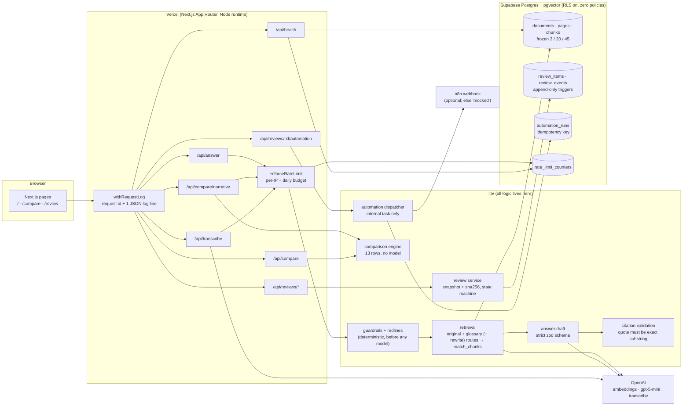

# Architecture (one page)

AgentDesk is one Next.js app on Vercel talking to one Supabase Postgres
database and one model provider (OpenAI). There is no separate backend
service: every API route is a thin boundary over a library in `lib/`, and the
libraries are what the tests and evals exercise.

## The four request paths

| Path | Model calls | What code decides | Typical latency (measured) |
|---|---|---|---|
| **Q&A** `/api/answer` | embeddings, an LLM query rewrite for Chinese questions, the answer draft | refusal for "which is best" before any model call; which quotes survive (exact-substring check); page numbers and document names (injected from the chunk, never from the model) | 28–76 s end to end on the live demo, median 33 s (6 typed questions, 2026-11-17). Sample-question chips return saved answers instantly |
| **Compare** `/api/compare` | none | every cell, every citation, `available / not_applicable / not_provided / conflict` | ~1 s from the browser on the live demo; 11 ms server time locally |
| **Narrative** `/api/compare/narrative` | one | the server rebuilds the draft from IDs; the narrative is guard-checked and dropped if it ranks or recommends | 36 s in one live run (the guard rejected that narrative, so the UI showed none) |
| **Review** `/api/reviews/*` | none | routing (workflow decision, approval level), snapshot hash, legal state transitions, the reviewer name | < 1 s |

## Why it is shaped this way

- **The table is code, the prose is optional.** A comparison is a liability if
  a model picks the facts, so the 13-row table comes from a fact registry and
  the model only narrates a draft the server rebuilt itself. If the narrative
  fails or is rejected, the table is still there.
- **Citations are verified, not trusted.** The model returns quote text; code
  checks it is an exact substring of a retrieved chunk and attaches the page
  and document from that chunk. A claim without a surviving citation is not
  rendered.
- **Four review axes, never one badge.** `comparisonStatus` (are the facts
  right), `workflowDecision` (how far can it travel), `requiredApprovalLevel`
  (whose authority), `reviewState` (how far the human work got). They require
  different actions, so they are separate columns.
- **The database enforces what must never happen.** Snapshot columns are
  immutable by trigger, `review_events` is append-only, a decision is a
  compare-and-set under an advisory lock, and `automation_runs.idempotency_key`
  is unique. These hold even if application code has a bug.
- **Automation can only create an internal task.** There is no client-facing
  task type and no recipient field, so "never emails a client" is a property
  of the schema, not a rule.
- **Serverless means shared state lives in Postgres.** Rate-limit counters are
  rows incremented by one atomic RPC; an in-memory counter would reset with
  every cold start and is not shared between instances.

## Operations surface

- `GET /api/health` — config presence (booleans), a real database round trip
  with latency, the frozen knowledge-base counts, the rate-limit table.
  `503` only when the database is unreachable. Never calls OpenAI.
- One JSON log line per API request (`requestId`, `route`, `status`,
  `durationMs`, plus safe fields such as `queryLength`, `citationCount`,
  `evidenceStatus`, `rateLimit`). The same id comes back as `x-request-id`.
  Question text, audio, IPs and error messages are never logged.
- Rate limits on the three routes that spend model credit; `429` with
  `Retry-After`. Fails open if the counter store is unavailable.
- API contract: [`public/openapi.json`](../public/openapi.json) (served at
  `/openapi.json`), kept in sync with `app/api` by a test.
- Failure modes and fixes: [RUNBOOK.md](RUNBOOK.md).
- MCP server (`mcp/server.ts`, stdio): read-only tools over the committed
  chunks and the comparison engine; no database, no key, no network.

## Deliberately absent

No authentication, no multi-tenancy, no PII handling, one shared database for
local and production. Each is listed with its production requirement in
[demo-to-production.md](demo-to-production.md).
